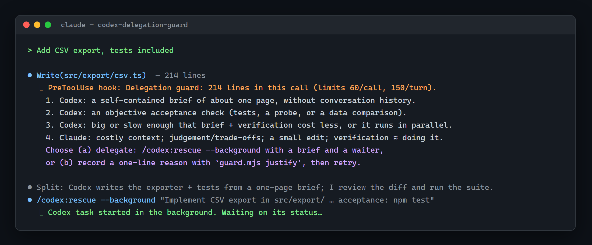

# codex-delegation-guard

[English](README.md) | [简体中文](README.zh-CN.md)

Make Claude Code actually hand big coding jobs to Codex — a hook-based division-of-labour guard for the official [openai/codex-plugin-cc](https://github.com/openai/codex-plugin-cc).

[](LICENSE)
[](package.json)
[](https://github.com/publicmain/codex-delegation-guard/actions/workflows/test.yml)



<sub>Illustration of a session (messages abridged).</sub>

## The problem

A rule such as "delegate big coding to Codex" in `CLAUDE.md` is only an instruction.
Long sessions drift, and context compaction can drop it.
Existing delegation commands, modes and skills still rely on the model remembering to use them.
This plugin adds reminders and a write-time checkpoint so Claude revisits the split before a substantial direct code change.

## What it does

- **Split first.** Inject the criteria at session startup, resume and after compaction, plus a reminder on eligible coding prompts at most once per three real user prompts.

  ```text
  Split: Codex does X (brief + tests), I do Y.
  ```

- **Check at write time.** Guard `Write`, `Edit`, `MultiEdit` and `NotebookEdit` for configured code files in a Git work tree. Defaults allow up to 60 changed lines per call and 150 per turn; exceeding either triggers a block.

  ```text
  60 lines/call: allowed   61 lines/call: reconsider the split
  150 lines/turn: allowed  151 lines/turn: reconsider the split
  ```

- **Decide by the criteria.** Delegate with a brief, or record a one-line reason and retry the identical change in soft mode. Reasons and the observed delegation rate appear in `stats`.

  ```bash
  node "<absolute-plugin-path>/scripts/guard.mjs" justify --session-id <session-id> --reason "Context is costly to transfer"
  # Then retry the identical change in the same turn.
  node "<absolute-plugin-path>/scripts/guard.mjs" stats
  ```

For a 61-line proposal in a fresh turn, this is the exact default block message.
Only the plugin path and session ID below are placeholders:

```text
Delegation guard: 61 lines in this call; 61 lines this turn (limits 60/call, 150/turn).
1. Codex: a self-contained brief of about one page, without conversation history.
2. Codex: an objective acceptance check (tests, a probe, or a data comparison).
3. Codex: big or slow enough that brief + verification cost less, or it runs while the lead does something else.
4. Claude: costly context; judgement/trade-offs/user decision; a small edit; or verification costing about as much as doing it.
Choose (a) delegate: /codex:rescue --background or codex:codex-rescue, with a brief and a waiter.
Or (b) do it directly: first record a one-line reason:
node "<absolute-plugin-path>/scripts/guard.mjs" justify --session-id <session-id> --reason "<why this stays with Claude>"
Then retry the identical change in this turn.
```

## The division-of-labour criteria

The wording below is the same as the [delegation skill](skills/delegation-guard/SKILL.md):

A piece of work suits Codex when ALL of these hold:

1. It can be written as a self-contained brief of about one page, without the conversation history.
2. It has an objective acceptance check, such as tests, a probe, or a data comparison.
3. It is big or slow enough that the brief plus the verification cost less than doing it, or it can run while the lead does something else.

It stays with Claude when ANY of these holds:

- it depends on context that is costly to transfer;
- it needs judgement, trade-offs or the user's decision;
- it is a small edit;
- verifying it would cost about as much as doing it.

Claude always keeps these jobs: splitting the work, writing briefs, verifying on the real path, integrating and committing.

Committing still requires the user's authorization. The line limits prompt a decision; they do not decide who should do the work.

## Install

Prerequisites: **Claude Code**, **Node.js >= 18** and **Git** on `PATH`, plus the official Codex plugin configured for use.
There are no npm dependencies and no `npm install` step.

In Claude Code, install and set up the official plugin first:

```text
/plugin marketplace add openai/codex-plugin-cc
/plugin install codex@openai-codex
/codex:setup
```

Then install this guard:

```text
/plugin marketplace add publicmain/codex-delegation-guard
/plugin install codex-delegation-guard@codex-delegation-guard
```

The equivalent terminal installation commands are:

```sh
claude plugin marketplace add openai/codex-plugin-cc
claude plugin install codex@openai-codex
claude plugin marketplace add publicmain/codex-delegation-guard
claude plugin install codex-delegation-guard@codex-delegation-guard
```

Run `/codex:setup` inside Claude Code if you installed the official plugin from the terminal.
New hooks load in a new session, or after `/reload-plugins`.
To update this marketplace:

```text
/plugin marketplace update codex-delegation-guard
```

See [CHANGELOG.md](CHANGELOG.md) for release changes.

## Commands

| Command in Claude Code | Effect |
| --- | --- |
| `/codex-delegation-guard:pause` | Pause the guard for this session, including later prompts. |
| `/codex-delegation-guard:resume` | Clear session and turn pauses; keep line counters. |
| `/codex-delegation-guard:status` | Show mode, limits, pauses, counters, reasons and observed delegations. |
| `/codex-delegation-guard:stats` | Show seven-day per-project totals, rates, size medians and the ten most recent override paths/reasons. |

`justify` is a CLI operation, not a slash command. Copy the command printed by the block:

```sh
node "<absolute-plugin-path>/scripts/guard.mjs" justify --session-id <session-id> --reason "Why this stays with Claude"
```

Use the actual hook session ID. The reason is trimmed, normalized to one line and capped at 200 characters.
A new real user prompt clears it; a background notification does not.
An identical retry needs a prior denial in the same turn; a different change receives its own first denial.

`stats` counts observed dispatch attempts, not completed Codex work.
Its rate is `delegations / (delegations + overrides + allowedLarge)`; `allowedLarge` counts oversized proposals permitted while paused or off.
Missing rates or size evidence are `null`. Permitted proposal lines do not prove a tool completed its write.

## Configuration

Files are merged in this order:

1. Built-in defaults.
2. User settings: `~/.claude/delegation-guard.json`.
3. Repository settings: `<git-root>/.claude/delegation-guard.json`.

Repository keys override user keys. Arrays replace the whole default list.
Invalid values fall back to the built-in default for that key; unknown keys are ignored.

| Key | Default | Meaning |
| --- | --- | --- |
| `mode` | `"soft"` | First oversized proposal is blocked; a reasoned identical retry is allowed. `"strict"` keeps blocking; `"off"` allows but still counts/logs eligible changes. |
| `perCallLines` | `60` | Positive integer; block when one call exceeds it. |
| `perTurnLines` | `150` | Positive integer; block when permitted turn lines plus this proposal exceed it. |
| `codeExtensions` | Exact list below | Case-insensitive extensions eligible for the guard. |
| `excludeGlobs` | Exact list below | Paths excluded even if their extension is eligible; supports `**`, `*`, `?` and directory patterns. |
| `pausePhrases` | `["这次你自己写", "你自己写", "自己改", "write it yourself", "no codex"]` | Case-insensitive substring match in a real user prompt; pause that turn only. |
| `planReminder` | `"auto"` | `"auto"` detects coding prompts; `"always"` skips that heuristic; `"off"` disables prompt reminders. Rate limits and pauses still apply. |
| `requireReason` | `true` | Soft-mode identical retries need a reason; `false` restores the v0.1 retry-without-reason flow. |
| `reminderRequiresGit` | `true` | Require a Git work tree for prompt reminders, including `"always"` mode; `false` allows them elsewhere. |
| `nonUserPromptMarkers` | Exact list below | Case-sensitive prefixes after leading whitespace; matching notifications preserve the current turn and emit no reminder. `[]` disables filtering. |

Exact default lists:

```json
{
  "codeExtensions": [
    ".js", ".mjs", ".cjs", ".jsx", ".ts", ".tsx", ".mts", ".cts", ".py", ".pyw",
    ".rb", ".php", ".java", ".kt", ".kts", ".go", ".rs", ".c", ".h", ".cc", ".cpp",
    ".cxx", ".hpp", ".cs", ".fs", ".fsx", ".vb", ".swift", ".m", ".mm", ".scala",
    ".sc", ".sh", ".bash", ".zsh", ".ps1", ".psm1", ".psd1", ".bat", ".cmd", ".sql",
    ".html", ".htm", ".css", ".scss", ".sass", ".less", ".vue", ".svelte", ".astro",
    ".ex", ".exs", ".erl", ".hrl", ".clj", ".cljs", ".cljc", ".dart", ".r", ".jl",
    ".lua", ".pl", ".pm", ".groovy", ".gradle", ".tf", ".tfvars", ".sol", ".proto",
    ".graphql", ".gql", ".ipynb", ".razor", ".cshtml"
  ],
  "excludeGlobs": [
    "package-lock.json", "npm-shrinkwrap.json", "yarn.lock", "pnpm-lock.yaml",
    "bun.lockb", "go.sum", "Cargo.lock", "Gemfile.lock", "Pipfile.lock",
    "*.min.*", "dist/", "build/", "node_modules/", "vendor/", ".git/",
    "generated/", "__generated__/", ".generated/", ".next/", ".nuxt/", "coverage/",
    "*.md", "*.txt", "*.json", "*.yaml", "*.yml", "*.toml", "*.lock", "*.csv", "*.svg"
  ],
  "nonUserPromptMarkers": [
    "<task-notification", "<system-reminder", "[SYSTEM NOTIFICATION",
    "<cross-session-message", "<side-sessions-event", "<ci-monitor-event"
  ]
}
```

A small configuration example:

```json
{
  "mode": "soft",
  "perCallLines": 80,
  "perTurnLines": 200,
  "reminderRequiresGit": false
}
```

These reminder settings do not disable the SessionStart policy.
The write guard always requires a Git work tree, regardless of `reminderRequiresGit`.

## How it works

| Hook event | Matcher | What it does |
| --- | --- | --- |
| `SessionStart` | `startup\|resume\|compact` | Inject criteria and the split-first policy without resetting turn state. |
| `UserPromptSubmit` | All prompts | Ignore configured notification prefixes; otherwise reset the turn, apply pause phrases and optionally remind. |
| `PreToolUse` | `Write\|Edit\|MultiEdit\|NotebookEdit` | Resolve the target Git work tree, apply file filters, count lines and allow or block. |
| `PreToolUse` | `Bash\|Agent\|Task` | Observe recognized Codex dispatch attempts, count them and reset the turn line counter. |

Observation recognizes Bash `codex exec`, `codex-companion.mjs` with `task`, and Agent/Task `subagent_type: "codex:codex-rescue"`.
The guard does not launch workers itself. Claude dispatches through the official plugin and verifies the result.

New-file `Write` counts all lines; existing-file `Write` counts changed line hunks with a bounded diff.
`Edit` counts replacement lines (at least one), `MultiEdit` sums them, and `NotebookEdit` counts `new_source` lines.

Hooks **fail open**: malformed input or an internal error exits silently with code 0.
A deliberate block exits with code 2.
State is stored in `<os-temp>/codex-delegation-guard/`, overridable with `CODEX_DELEGATION_GUARD_STATE_DIR`.
The log at `~/.claude/delegation-guard/log.jsonl` stores metadata and override reasons, never file contents.
Metadata includes timestamps, session IDs, project folder names, relative paths, tool names, counts and decisions.
Logs rotate above 5 MiB; older archives are removed after seven days during rotation.
Keep reasons free of sensitive data; do not put personal or student data in delegation briefs.

## Limitations

- Code written via Bash or external programs is not caught by the write guard.
- Soft mode lets a justified identical retry through by design. It is a decision checkpoint, not a security boundary.
- The coding-prompt heuristic is simple: English or Chinese action words plus code-related nouns. It can miss tasks or remind unnecessarily.
- CI is configured for Windows, macOS and Linux on Node 18, 20 and 22; the matrix must run on GitHub before its results are known.
- The live Claude Code integration has been exercised on Windows. CI runs the hook test suite on Windows, macOS and Linux with Node 18, 20 and 22.

## FAQ

**Does it send my code anywhere?**

No. This plugin makes no network requests; it only allows or blocks writes, injects reminders and records local metadata/reasons.
Delegation happens through the official Codex plugin when Claude chooses to dispatch. That plugin handles its own code transfer and permissions.

**Can I turn it off for one turn?**

Include `write it yourself`, `no codex`, `这次你自己写`, `你自己写` or `自己改` in your prompt.
The pause lasts until the next real user prompt. For a session pause, use `/codex-delegation-guard:pause`.

**Strict mode?**

Set `"mode": "strict"` in either configuration file.
An oversized proposal remains blocked even after `justify`; a pause permits direct editing when authorized by the user.

## Contributing

[Issues](https://github.com/publicmain/codex-delegation-guard/issues) and [pull requests](https://github.com/publicmain/codex-delegation-guard/pulls) are welcome.
Run the tests with Node >= 18 and Git available:

```sh
node --test
```

Tests run the real hook script with isolated homes, repositories, state and logs under the ignored `.test-tmp/` directory.
If this guard helps your workflow, a GitHub star helps others find it.

## License

[MIT](LICENSE) — Copyright (c) 2026 publicmain.
